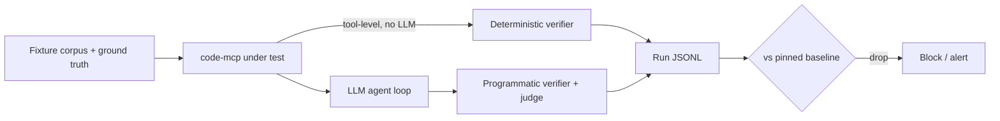

# Evaluating code-mcp and the agent that uses it

## Core principle

code-mcp is not the agent. It is four deliberately simple tools
(`grep`, `find`, `cat`, `memories`); the intelligence lives in the client
LLM. Evaluate both layers separately, or a regression will tell you
nothing about *where* it broke:

- **Tool returned the wrong set** → server (code-mcp) regression.
- **Tool returned the right set, answer was wrong** → model/prompt regression.

Logging every tool call per run is what makes that attribution possible.



## Tier 1 — Tool correctness (deterministic, every PR)

Black-box via the MCP protocol, not just `cargo test` — this also catches
wiring, schema, and `structured_content` regressions. Fixtures: a synthetic
tree with planted needles, plus this repo at a pinned commit.

Verify the contract fields in `ToolResponse` (`truncated`,
`truncation_reason`, `match_count`, error counts), not just the text body.

| Category | Example case | Pass condition |
|---|---|---|
| Retrieval | `grep "PeerLimiter"`, each `output_mode` | Exact file/line set; `match_count` matches |
| Caps | 200 matches, `max_results=10` | Exactly 10, `truncated=true`, `reason=max_results` |
| Pagination | `cat` a 5k-line file, page via `offset` | Pages reconstruct the file exactly |
| Scope (security) | `cat /etc/passwd`, `../` traversal, symlink → outside | All rejected `invalid_params` — hard gate, 100% required |
| Semantics traps | Gitignored file; hidden file; invalid regex; lookaround pattern | Matches documented behavior (incl. the `.git/`-only gitignore quirk) |
| Memories | No `MEMORY.md` → listing; `name="../x"` | Index/listing correct; traversal rejected |

Score: precision/recall/F1 on returned file sets against hand-labeled
ground truth. Line-level matching is exact — this layer is deterministic.

## Tier 2 — Agent end-to-end (LLM in loop, nightly / pre-release)

Same fixtures, natural-language tasks, the real model plus this server.
Start with ~30–50 tasks, versioned in-repo (`evals/tasks.jsonl`):

```json
{"id":"gate-01","repo":"self@a1b2c3","prompt":"How does a forged Mcp-Session-Id get handled when the session cap is reached? Cite files.","expect":{"files":["src/gate.rs"],"must_mention":["rate","session"],"must_not":["limiter.rs evicts the session"]},"trials":5}
```

Task categories:

- **Locate-definition** — find where a symbol/behaviour lives.
- **Trace-flow** — e.g. gate → limiter, reaper → ActivityTracker.
- **Cross-repo search** — the actual selling point; use a multi-repo fixture.
- **Comprehension/gotchas** — explain non-obvious behaviour and edge cases.
- **Negative tasks** — "where is OAuth handled?" Correct answer: nowhere.
  Measures hallucination/abstention.
- **Memory-orientation** — does calling `memories` first reduce total tool calls?

### Scoring — programmatic first, judge last

1. **Citation check** (cheap, kills most hallucination): every cited
   `file:line` must exist and contain the claimed symbol. Unverifiable
   citation = fail.
2. **Set F1** on files the agent should have *found* (from transcript tool
   calls plus the final answer).
3. **Efficiency:** tool calls, tokens, wall-clock to correct answer — a
   quality-preserving regression often shows up here first.
4. **LLM-as-judge** only for synthesis quality, with a written rubric,
   judge from a different model family than the model under test,
   calibrated against ~20 human-labeled answers (re-check agreement when
   swapping judges).

## Spotting regressions

- **Pin everything per run:** `{server_sha, model_id, prompt_hash,
  judge_id, task_set_version}` in each result row. An unpinned model means
  you are evaluating provider drift, not your code.
- **Nondeterminism:** temperature 0 still is not deterministic. Run each
  task 3–5 trials; report `pass^k` (all trials pass) for security/negative
  tasks, mean pass rate elsewhere. Never gate on a single run.
- **Gate rules:**
  - Tier 1: 100% or block merge.
  - Tier 2: block if the aggregate drops >5 points vs baseline *or* any
    security/negative task flips to fail. List per-task flips in the
    report — aggregate-only reporting hides real breakage.
- **Contamination:** this repo is public, so models may have memorized it.
  Keep a private/synthetic holdout set (renamed symbols, planted code),
  rotated periodically. If public-set scores rise while holdout falls,
  you are measuring memorization.
- **Baseline hygiene:** only promote a baseline after human review of the
  diff; store baselines in git next to the tasks.

## Rollout

1. **Tier 1 golden suite first** (~1 day, reuses existing test fixtures):
   immediate merge protection.
2. **Add ~15 hand-written Tier 2 tasks** on this repo itself.
3. **Grow from real failures:** user questions the agent actually got
   wrong are the highest-value eval cases you will ever get — add each
   one as a regression task before fixing it.
